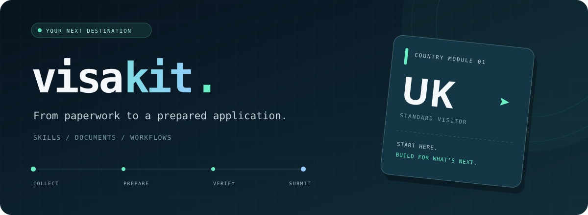

<p align="center">
  
</p>

<p align="center">
  <a href="README.md">简体中文</a> · <strong>English</strong>
</p>

<p align="center">
  <strong>Turn scattered documents into a well-supported visa application.</strong><br />
  Skills, document workflows & practical tools for visa preparation.
</p>

<p align="center">
  <code>🇬🇧 UK · AVAILABLE</code> &nbsp;
  <code>🌍 MULTI-COUNTRY · NEXT</code> &nbsp;
  <code>🔒 APPLICANT DATA · LOCAL</code>
</p>

---

## Share the details once. Keep the application moving.

VisaKit is a collection of visa preparation skills and tools for AI assistants. It connects document preparation, translation, fact-checking, online forms, appointment booking, uploads and print preparation. It reduces repetitive questions while preserving the facts and confirmations that applicants must provide themselves.

**Currently supported: UK Standard Visitor applications by Chinese citizens for tourism or visits to family and friends.** Other destinations and visa categories are not yet implemented. Each destination will have its own workflow, official sources and questionnaire.

```text
  COLLECT     →     PREPARE     →     REVIEW     →     SUBMIT     →     HAND OVER
  Details           Documents        Facts            Forms            Appointment
  & answers         & translations   & explanations   & uploads        & print pack
```

| Capability | Approach |
| :--- | :--- |
| Collect details in batches | Extract readable facts from supplied documents, then ask for missing information together; never guess personal facts |
| Prepare complete translations | Keep the original, full translation and corresponding declaration together; a real person is responsible for checking the translation |
| Process document photos | Inspect images individually, correct perspective and curved pages, combine files and check legibility |
| Explain travel funds | Distinguish salary, bonuses, transfers between the applicant's own accounts and available assets; annotate and explain where useful |
| Continue online applications | Reuse confirmed answers while respecting the authorised scope and steps requiring the applicant's involvement |
| Complete the upload handover | Verify the saved document set and official confirmation before updating the print pack |

## Starting with the UK

| Destination | Current scope | Entry point |
| :--- | :--- | :--- |
| 🇬🇧 United Kingdom | Chinese citizens · Standard Visitor · Tourism / visiting family and friends | [UK visitor visa skill](skills/uk-visitor-visa/SKILL.md) |
| 🌍 Other destinations | Planned extension; no modules available yet | See the extension guidelines below |

### Start an application

```bash
git clone https://github.com/PoTsui99/visa-kit.git
cd visa-kit
```

Give an assistant that supports skill files the path to [SKILL.md](skills/uk-visitor-visa/SKILL.md). Specify where you are applying, the purpose of your visit, your document directory and how far you want the assistant to proceed. For example:

> Use this repository's uk-visitor-visa skill to help with my UK tourist visa application. First read the documents I specify, then ask for missing information in one batch. Do not assume personal facts. Start with document preparation and a form draft that can be saved; make external submissions only within my explicit authorisation.

The [applicant questionnaire](skills/uk-visitor-visa/assets/Applicant_Questionnaire.md) covers identity, addresses, employment, funds, travel plans and relevant history. Security and character questions can be confirmed together as a complete, clearly defined group. Suggested answers remain drafts until the applicant verifies them.

The skill instructions, questionnaire and most references are currently written in Chinese. The document templates are in English; this README does not imply that every resource has an English translation.

<details>
<summary><strong>Local tools: check PDFs and build a print pack</strong></summary>

The tools require Python 3 and pypdf. Document authoring and browser control are provided by the assistant's environment. These scripts do not submit applications.

```bash
python3 -m venv .venv
source .venv/bin/activate
python -m pip install -r requirements-dev.txt

# Inspect only the specified files without modifying the originals
python skills/uk-visitor-visa/scripts/preflight_pdfs.py \
  --files /path/to/Passport.pdf /path/to/Bank_Statement.pdf

# Copy the official appointment letter and checklist; verify byte integrity
python skills/uk-visitor-visa/scripts/build_print_pack.py \
  --appointment /path/to/Appointment_Confirmation.pdf \
  --checklist /path/to/UKVI_Checklist.pdf \
  --destination /path/to/application/To_Print

python -m unittest discover -s tests -v
```

The PDF size limit is configurable; the destination website's actual rules take precedence. The print script stops if the folder already contains a different version. Verify the new official files, then back up the old copies outside the print folder. Never edit an official confirmation's document list to make an incomplete upload appear complete.

</details>

## Repository layout

```text
visa-kit/
├── assets/                         # Repository artwork
├── skills/
│   └── uk-visitor-visa/
│       ├── SKILL.md                # Entry point and scope
│       ├── agents/                 # Skill display metadata
│       ├── assets/                 # Blank questionnaire and English templates
│       ├── references/             # Official sources, documents, funds and web workflows
│       └── scripts/                # PDF checks and print pack tools
├── tests/                          # Synthetic test files; no applicant documents
└── requirements-dev.txt
```

## A separate workflow for each destination

Add future modules under `skills/<destination>-<visa-type>/`. Define the eligible applicants, visa route, official sources, questionnaire, evidence and website workflow for each module. Reuse verified tools without assuming that UK document requirements, fees, visa durations or declarations apply elsewhere.

Fees, evidence requirements and website flows change. Consult current official sources when handling an application and record the verification date. Continue existing applications wherever possible to avoid duplicate payments, bookings or uploads.

## Keep applicant data in the application directory

This repository contains workflows, blank templates and tools. Keep real identity documents, bank statements, addresses, signatures, answers, screenshots, application references, browser sessions and passwords in a private application directory outside the repository. `.gitignore` is a supporting measure; always inspect the actual staged files before committing.

The person who checks a translation is responsible for its declaration. Handle personal declarations, signatures, payments and account actions according to the applicant's authorisation and the applicable tool rules. VisaKit assists with preparation and application handling; visa decisions remain with the responsible authorities.

<p align="center"><sub>Prepared with care. Grounded in evidence. Ready for the next destination.</sub></p>
