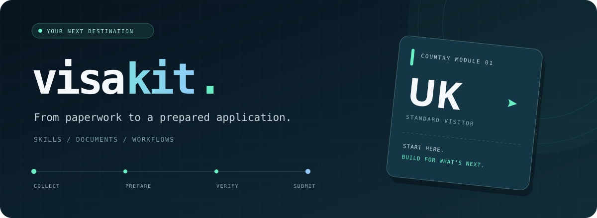

<p align="center">
  
</p>

<p align="center">
  <strong>简体中文</strong> · <a href="README.en.md">English</a>
</p>

<p align="center">
  <strong>把散落的材料，变成一份有据可查的签证申请。</strong><br />
  Skills, document workflows & practical tools for visa preparation.
</p>

<p align="center">
  <code>🇬🇧 UK · AVAILABLE</code> &nbsp;
  <code>🌍 MULTI-COUNTRY · NEXT</code> &nbsp;
  <code>🔒 APPLICANT DATA · LOCAL</code>
</p>

---

## 一次说明，连续办理

VisaKit 是一套面向 AI 助手的签证办理技能与工具。它把材料整理、翻译、信息核对、在线填表、预约上传和打印交接连起来，减少逐题往返，也保留必须由申请人核实的事实和确认节点。

**目前仅支持：中国公民申请英国 Standard Visitor 旅游／探亲访友签证。** 其他国家和签证类别尚未实现；各目的地将分别维护自己的流程、官方来源和问卷。

```text
  COLLECT          PREPARE          REVIEW           SUBMIT          HAND OVER
  一次收集    →    整理与翻译   →    核对与说明   →    填表与上传   →    预约与打印
```

| 能做什么 | 怎么做 |
| :--- | :--- |
| 集中收集信息 | 先从清晰材料提取，再一次询问缺项；个人信息不猜填 |
| 准备完整译文 | 原文、逐项译文和对应声明成套；真人承担核对责任 |
| 处理拍摄材料 | 逐张检查、透视校正、曲边展开、合并和清晰度核对 |
| 理清旅行资金 | 区分工资、奖金、本人账户互转与可用资产；按需标注和说明 |
| 接续在线办理 | 复用已确认答案；遵守授权范围和本人操作节点 |
| 完成上传交接 | 最终保存后核对文件集合及官方确认函，再更新打印包 |

## 支付和正式提交前，必须人工核对

每次支付，以及申请递交、声明接受、预约确认、材料最终上传／补交／替换前，助手必须先展示本次具体内容，由申请人或其明确授权且有权核对的人工代表检查并明确确认。核对范围包括申请答案和差异、文件及版本、目标网站与申请、预约信息，以及收款方、币种、金额和服务项目。付款由本人完成；正式提交按所用工具规则执行。

“帮我办完”等概括授权、默认答案、沉默和历史确认不能代替本次核对。已明确核对的同一批次可连续执行所列步骤；内容、文件、金额或预约发生实质变化时须重新核对。普通翻页、读取和可编辑草稿保存可在已授权范围内继续。该门槛由技能指令规定，使用者仍需监督实际操作。

## 从英国开始

| 目的地 | 当前范围 | 入口 |
| :--- | :--- | :--- |
| 🇬🇧 英国 | 中国公民 · Standard Visitor · 旅游／探亲访友 | [英国签证技能](skills/uk-visitor-visa/SKILL.md) |
| 🌍 其他目的地 | 预留扩展，尚无可用模块 | 见下方扩展约定 |

### 开始一次申请

```bash
git clone https://github.com/PoTsui99/visa-kit.git
cd visa-kit
```

将 [SKILL.md](skills/uk-visitor-visa/SKILL.md) 的路径提供给支持技能文件的助手，并说明申请地点、目的、材料目录，以及希望协助到哪一步。可以直接这样开始：

> 使用本仓库的 uk-visitor-visa 技能，协助我申请英国旅游签证。请先读取我指定的材料，集中列出还缺的问题；个人事实不要设默认答案。先完成材料和可保存的表格草稿，外部提交按我的明确授权执行。

[一次性问卷](skills/uk-visitor-visa/assets/Applicant_Questionnaire.md) 包含身份、住址、工作、资金、行程和申报历史。安全品行题可以集中确认完整问题组；常见拟答始终是待本人核实的草稿。

<details>
<summary><strong>本地工具：检查 PDF 与创建打印包</strong></summary>

需要 Python 3 和 pypdf；文档制作与浏览器操作由所用助手环境提供。工具不会自行递交申请。

```bash
python3 -m venv .venv
source .venv/bin/activate
python -m pip install -r requirements-dev.txt

# 只检查明确列出的文件；不修改原件
python skills/uk-visitor-visa/scripts/preflight_pdfs.py \
  --files /path/to/Passport.pdf /path/to/Bank_Statement.pdf

# 复制官方预约函和材料清单，核对字节一致
python skills/uk-visitor-visa/scripts/build_print_pack.py \
  --appointment /path/to/Appointment_Confirmation.pdf \
  --checklist /path/to/UKVI_Checklist.pdf \
  --destination /path/to/application/To_Print

python -m unittest discover -s tests -v
```

PDF 大小限制可配置，实际以目标网站为准。打印目录已有不同版本时脚本会停止；先核实新版官方文件，再将旧件备份到打印目录之外。未完成上传时，不能自行改写官方确认函的材料列表。

</details>

## 目录

```text
visa-kit/
├── assets/                         # 仓库展示素材
├── skills/
│   └── uk-visitor-visa/
│       ├── SKILL.md                # 入口与办理边界
│       ├── agents/                 # 技能显示配置
│       ├── assets/                 # 空白问卷和英文文书模板
│       ├── references/             # 官方来源、材料、资金、网站流程
│       └── scripts/                # PDF 检查与打印包工具
├── tests/                          # 合成文件测试，不含申请材料
└── requirements-dev.txt
```

## 让每个目的地有自己的流程

后续模块放在 `skills/<destination>-<visa-type>/`。扩展时分别确定适用申请人、签证路线、官方来源、问卷、证据和网站流程；复用已验证的工具，不直接套用英国的材料要求、费用、期限或声明。

费用、材料要求和网页流程会变化。办理时访问当时的官方来源，并标明实际核实日期；已有申请优先接续，避免重复付款、预约或上传。

## 申请数据留在申请目录

本仓库保存流程、空白模板和工具。真实证件、流水、地址、签名、答案、截图、申请编号、浏览器会话和密码都应放在仓库之外的私人申请目录；`.gitignore` 只是辅助，提交前仍须检查实际暂存文件。

翻译声明由实际核对者负责。本人声明、签名、付款及账户操作按授权和工具规则完成。

## 免责声明

**在适用法律允许的最大范围内，作者及贡献者不对使用本项目导致的拒签、延误、申请费／服务费／旅行费用损失或其他损害承担责任。** 项目按现状提供，不保证准确性、适用性或获签结果；使用者须自行核实官方要求并人工检查最终内容。完整范围及不能依法排除的责任例外见 [免责声明](DISCLAIMER.md#简体中文)。

<p align="center"><sub>Prepared with care. Grounded in evidence. Ready for the next destination.</sub></p>
